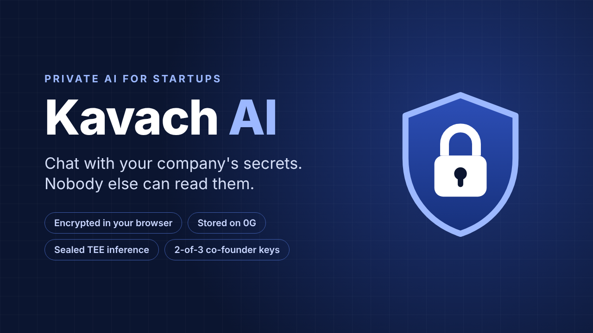
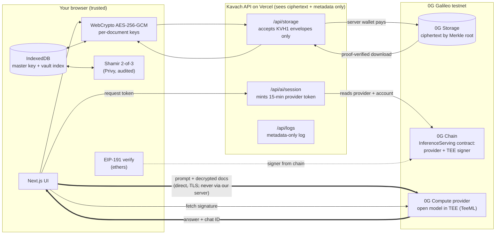

# Kavach AI 🛡️

**A private AI assistant for small startups.** Upload sensitive documents (customer lists, pricing, contracts), then chat with an AI about them. Nobody but your company can read them: not us (the app), not the storage network, not the AI provider.

*Kavach (कवच) means "armour" in Hindi.* Built for ETHGlobal Mumbai on **0G Storage** and **0G Compute** (Galileo testnet).

**Live demo:** https://kavach-ai-khaki.vercel.app (try "Load Brewline Coffee Co.", then open the Proof tab)



> **Status (testnet):** encryption, 0G Storage, the vault, key ceremony/recovery and sharing all work end-to-end against 0G Galileo. The sealed-inference path is fully implemented and picks a provider from the on-chain list automatically, but as of Nov 2026 no 0G-verified open-model TEE chat provider is available on testnet (new ones are listed but not yet acknowledged by 0G). Until one is, chat runs in a clearly labelled demo mode that never shows a fake proof. See [`submission/FINAL_REPORT.md`](submission/FINAL_REPORT.md).

---

## The problem

Small teams paste their most sensitive data into AI chatbots every day: who their customers are, what they pay, what the supplier contract says. That data then lives on someone else's servers, readable by staff, logs, subpoenas and future training runs. Startups can't afford an enterprise "private deployment", so they either leak or go without AI.

## The solution

| Promise | How Kavach does it |
|---|---|
| Documents are unreadable outside your company | Each document is encrypted **in the browser** with its own random AES-256-GCM key. Document keys are wrapped by a company master key that never leaves the device. |
| No central storage to breach | Only ciphertext is uploaded, to **0G Storage** (decentralised, content-addressed by Merkle root). Our API rejects anything that isn't a Kavach ciphertext envelope. |
| The AI provider can't read your questions | The **browser** sends the prompt directly to an open model running inside a hardware TEE on **0G Compute** (TeeML, Phala dstack). Our server only issues a 15-minute access token, and only for providers whose TEE signer 0G has acknowledged on-chain. |
| Every answer is checkable | The browser fetches the TEE's signature for the response and verifies it locally (EIP-191) against the TEE signer address registered on-chain. Each answer shows model, provider, chat/request ID and verification status. |
| Nothing is remembered by accident | Chats live in memory only and vanish on reload. **Save to vault** turns a chosen answer into an encrypted note. |
| No single point of failure for the key | The master key is split with **Shamir secret sharing** into 3 co-founder shares; **any 2** recover it. One share alone reveals nothing. |
| Controlled sharing | Expiring read-only links for employees; revoking re-encrypts the documents with new keys. |

## Architecture



**Key hierarchy:** `master key` (random 256-bit, IndexedDB, Shamir-split) → wraps each `document key` (random 256-bit) → encrypts the document payload (`"KVH1" | IV | AES-GCM ciphertext+tag`, with the document ID bound as AAD).

## How 0G is used, and what breaks without it

| 0G component | Used for | Without it |
|---|---|---|
| **0G Storage** (TS SDK, turbo indexer) | Every document, saved answer and share manifest is stored as ciphertext, addressed by Merkle root hash; downloads are Merkle-proof verified. The Proof screen shows the raw bytes fetched back from 0G. | We'd need our own database or a cloud bucket: a central honeypot we control, and a vendor who can delete or withhold your data. Share links (which point at root hashes) would depend on our uptime. |
| **0G Compute sealed inference** (Direct path, TeeML provider) | The AI model runs inside a TEE; prompts go browser → enclave. Responses are signed by the TEE key registered on-chain. | We'd have to send your documents to a normal AI API (OpenAI, etc.) that can read and retain them, so the core promise fails. |
| **0G Chain** (InferenceServing + Ledger contracts) | Source of truth for the provider's endpoint, model and TEE signer address; pays the provider. | No public way to check *which* key should have signed an answer. |

The app's server wallet (`ZG_PRIVATE_KEY`) pays for storage and inference, so users need no crypto wallet.

## Who can see what

| Party | Sees |
|---|---|
| Kavach server | Ciphertext sizes and SHA-256 hashes, 0G root hashes, timings, request counts, IP addresses (Vercel). Never keys, filenames, documents, prompts or answers. |
| 0G storage nodes | Encrypted blobs and their size. |
| 0G compute provider's host | Encrypted traffic into the TEE. The model inside the TEE processes your prompt in plaintext. |
| Anyone with 2 co-founder shares | Everything (that is the point). |

## Run it

```bash
nvm use 22            # Node 22.x
npm install
cp .env.example .env.local   # set ZG_PRIVATE_KEY (throwaway Galileo testnet wallet)
npm run dev           # http://localhost:3000
```

Without `ZG_PRIVATE_KEY` the app still works: documents stay encrypted on the device ("local only") and chat runs in a clearly labelled demo mode.

| Command | What it does |
|---|---|
| `npm run typecheck` / `npm run lint` / `npm test` / `npm run build` | Quality gates (Vitest: 26 tests for crypto, Shamir, vault, sharing, demo engine) |
| `npm run check:0g` | Live risk test: encrypted blob round-trip on 0G Storage + one sealed-inference call with signature verification |
| `npm run zg:fund -- --yes` | Tops the compute sub-account for the sealed provider up to 1.2 0G (providers require ≥ 1 0G locked) |
| `npm run zg:cost` | Measures the current upload cost (gas, storage fee, admission floor) without spending anything |

### Deploy to Vercel

1. Import the GitHub repo in Vercel (framework: Next.js, defaults are fine; Node 22 comes from `engines`).
2. Add environment variable **`ZG_PRIVATE_KEY`** (Production + Preview), using a throwaway testnet wallet. Optional overrides are documented in [`.env.example`](.env.example).
3. Deploy. Open `/api/status` to check that storage and inference are configured.

## Running costs (0G Galileo, measured 2026-11-14)

Each document, saved answer or share manifest is one 0G Storage upload: one `Flow.submit` transaction paid by the server wallet. Run `npm run zg:cost` to re-measure (it spends nothing).

| Item | Measured |
|---|---|
| Storage fee | 30,733,644,962 wei per 256-byte sector → **~0.00000025 0G** for a 2 KB document (negligible) |
| Gas per upload | **~295k–336k gas** (estimates for 100 B–1 MB ciphertexts; a real hackathon upload used ~298k). The app budgets 360k. |
| Gas price that gets mined | **1,000 gwei.** Nodes *admit* transactions from 100 gwei, but a 100 gwei upload sat unmined for 5+ minutes while a 1,000 gwei transaction was mined in 9 s. The RPC's suggested price (2,000 gwei) is 2× what's needed. During the hackathon (Nov 6) the price was 4 gwei. |
| **Cost per upload** | **≈ 0.30–0.34 0G** spent; the wallet must hold **≥ 0.36 0G** for the next upload to be attempted |
| **20 uploads** | **≈ 6.0–6.7 0G** spent; keep **≥ 7.2 0G** in the wallet (plus the 0.005 0G reserve) |
| Loading the demo company | 3 uploads ≈ 0.9–1.0 0G spent (needs ≥ 1.08 0G available) |

How the server pays (`src/lib/server/uploadCost.ts`, `src/lib/server/zgStorage.ts`):
- It pays 1,000 gwei instead of the RPC suggestion. If a node rejects that with a higher stated minimum, it moves up to that minimum (a rejection costs nothing) and drops back after 10 minutes. It never pays more than `ZG_MAX_GAS_PRICE_GWEI` (default 2,000).
- Before every upload it checks the balance against the real cost. If the wallet can't pay, the API answers `503 budget_exhausted` with the numbers, and the document stays encrypted on the visitor's device. `/api/status` shows `costPerUpload0G` and `uploadsAffordable`.
- If an earlier transaction from the wallet is stuck in the mempool, the next upload reuses its nonce at 2× price, replacing it instead of queuing behind it forever.

Why the live site failed on Nov 14: the SDK paid the RPC's 2,000 gwei suggestion, so one upload needed ~0.67 0G while the wallet held 0.09 0G. Depending on which check tripped first, that surfaced as `insufficient funds` or, during gas estimation, as `execution reverted … require(false)`. The node caps the simulated gas at balance ÷ gas price (0.09 0G ÷ 2,000 gwei = 46,764 gas, versus the ~310k needed), so the simulated submit runs out of gas. The supplier contract itself was fine: the same submission estimates normally at 4 or 100 gwei. It wasn't a duplicate and it wasn't the storage fee.

## Honest limits

- **TEEs trust the chip maker.** Sealed inference relies on Intel TDX / NVIDIA confidential-computing hardware and the provider's dstack attestation. A hardware flaw or a compromised attestation chain breaks the guarantee. Kavach verifies each response's signature against the on-chain TEE signer; it does **not** re-verify the TDX quote in the browser.
- **TLS endpoint:** the browser's TLS connection goes to the provider's dstack gateway/CVM. We rely on 0G's documentation that prompts are only decrypted inside the enclave.
- **The browser is the trust anchor.** The master key sits in IndexedDB. Malware on the device, a malicious browser extension, or a malicious update to this web app could steal it. That's true of every web-based end-to-end encrypted product.
- **Metadata is visible:** document sizes, upload times, number of documents, and the app wallet's on-chain activity.
- **Session tokens:** a token issued to the browser can spend the app's provider balance for up to 15 minutes. It's rate-limited per IP, and production would need per-user accounts.
- **Public demo budget:** the live demo's shared testnet wallet pays for every visitor's uploads. Uploads are rate-limited per IP, and the server refuses an upload when the wallet can't cover its real cost (see "Running costs"; ≈ 0.36 0G per upload at today's prices); documents then stay encrypted on the visitor's device.
- **Sharing:** expiry is enforced by the Kavach viewer, not by cryptography. Revocation re-keys documents, but 0G storage is immutable, so an old link still opens the *old* version, and nothing can erase what someone already saw.
- **Testnet + demo mode:** this build runs on Galileo testnet. If the sealed provider is unreachable or unfunded, chat says so and falls back to a **local keyword search** labelled "DEMO MODE: no AI model was used and nothing is verified". It never shows a fake proof.
- **Not new as a category.** Private AI chat using TEEs already exists, e.g. **Maple AI** and **Confer**. Kavach's additions are (1) a company vault with **co-founder split-key recovery** (2-of-3 Shamir) and per-document keys on decentralised storage, and (2) a **vault-only memory model**: chats are ephemeral, and only answers you explicitly save are kept, encrypted.
- Uploads are capped at 1 MB; PDFs need extractable text (no OCR).

## Repository map

```
src/lib/crypto/     AES-GCM envelopes, key wrapping, Shamir share encoding (+ tests)
src/lib/client/     IndexedDB vault, sealed-inference client, sharing, demo engine
src/lib/server/     0G Storage + Compute helpers (server only), metadata log
src/app/api/        storage, ai/session, status, logs routes
src/app/app/        vault, chat, keys, share, proof screens
src/app/s/          employee share viewer
scripts/            check-0g, fund-compute, brand rendering
submission/         logo, cover, demo script, final report
```

## Credits

Built solo for ETHGlobal Mumbai with **Claude Code** as the coding assistant. Product design and scope decisions are mine; the implementation was produced with Claude Code under my direction.

Uses [`shamir-secret-sharing`](https://github.com/privy-io/shamir-secret-sharing) by Privy (audited by Cure53 and Zellic), [`@0gfoundation/0g-storage-ts-sdk`](https://www.npmjs.com/package/@0gfoundation/0g-storage-ts-sdk), ethers, pdf.js and Next.js. Demo company data is entirely fictional.
